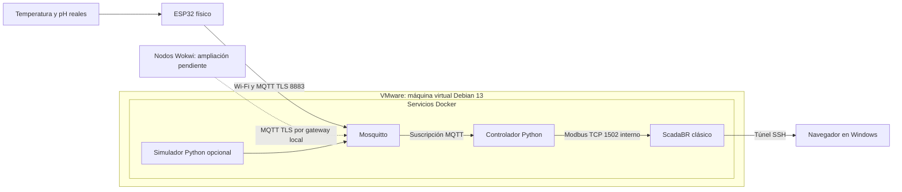

# Ciberfisicos_Project — piscifactoría IIoT con ESP32 y ScadaBR

Proyecto de ciberseguridad industrial para medir temperatura y pH, transportar
las lecturas mediante MQTT con TLS y supervisarlas en **ScadaBR clásico 1.2**.
Disponemos de **un ESP32 físico**. Se utilizará **Wokwi para estudiar la ampliación
con nodos virtuales**, conservando el dispositivo real como parte del montaje.

**Docker y todos los servicios del sistema se instalan y ejecutan dentro de una
máquina virtual Debian 13 en VMware.** Windows es el anfitrión: permite editar
código, grabar el ESP32 por USB, ejecutar Wokwi y abrir el navegador. El ESP32
se conecta por Wi-Fi al broker de Debian.

El repositorio contiene la base de software y el procedimiento de instalación.
El despliegue completo en la VM, los sensores y Wokwi requieren validación.
Actualmente se admite **un nodo por despliegue**; la supervisión simultánea
de varios nodos es una ampliación pendiente.

## 1. Qué hace y cómo circulan los datos



1. El **ESP32** lee el DS18B20 y la entrada analógica de pH aproximadamente cada
   cinco segundos. Añade identidad, secuencia y hora Unix a cada mensaje.
2. **Mosquitto** comprueba las credenciales, protege el transporte con TLS y
   limita los topics permitidos mediante ACL.
3. El **controlador Python** recibe la lectura y valida formato, identidad,
   frescura, rangos físicos, cambios plausibles y secuencia.
4. Si se acepta, guarda el último dato y su secuencia en **SQLite**, calcula las
   alarmas y actualiza seis registros **Modbus de solo lectura**.
5. **ScadaBR consulta esos registros**: hay que configurar sus puntos, tendencias,
   histórico, calidad y alarmas. No recibe MQTT directamente.
6. Si faltan datos durante más de unos 30 segundos, marca calidad 0 y activa
   la alarma de ausencia. Si rechaza un mensaje, conserva el último valor válido
   y marca su calidad como inválida hasta recibir una lectura válida nueva.

Una temperatura peligrosa y una medida no fiable son situaciones diferentes:
32 °C puede ser una lectura fiable con alarma de temperatura; una sonda sin
datos produce una alarma de calidad. No hay actuadores ni control de bombas.

## 2. Qué se ha implementado

| Parte | Archivos principales | Comportamiento |
|---|---|---|
| Firmware | `firmware/esp32/src/main.cpp`, `platformio.ini` | Arduino/PlatformIO, DS18B20, ADC1 para pH, NTP, TLS y secuencia NVS |
| Configuración de placa | `firmware/esp32/include/secrets.example.h` | Plantilla de Wi-Fi, broker, identidad, contraseña y CA pública |
| Entrada MQTT | `controller/app/mqtt_client.py` | Suscripción al topic del dispositivo y registro de aceptaciones/rechazos |
| Validación | `controller/app/validation.py` | JSON estricto, tipos, límites, frescura y saltos improbables |
| Estado | `controller/app/state.py` | Última lectura y secuencia persistentes; estado de calidad |
| Alarmas | `controller/app/alarms.py` | Umbrales de proceso diferenciados de fallos de datos |
| Modbus | `controller/app/modbus_server.py` | FC04, unidad 1, puerto interno 1502; rechazo de escrituras |
| Infraestructura | `infrastructure/compose.yaml`, Dockerfiles | Broker, controlador, ScadaBR opcional y simulador opcional |
| Seguridad MQTT | `infrastructure/mosquitto/` | TLS, autenticación y ACL por identidad |
| Preparación local | `scripts/init-lab.sh` | CA de laboratorio, certificado servidor y contraseñas aleatorias |
| Simulador Python | `simulator/simulate_esp32.py` | Datos sintéticos cada cinco segundos y contador persistente |
| Prueba de flujo | `scripts/verify-pipeline.sh` | Arranque con simulador, lectura Modbus y prueba de ausencia de datos |
| Pruebas y CI | `controller/tests/`, `.github/workflows/ci.yaml` | Python, Compose, flujo Docker y compilación ESP32 |
| Documentación | `docs/`, `security/`, `CONTRIBUTING.md` | Instalación, hardware, amenazas, controles, evidencias y colaboración |

No se versionan contraseñas reales, claves privadas, `.env`, `secrets.h`, bases
de datos ni el WAR. Los volúmenes conservan estado e histórico entre reinicios.
SQLite guarda el **último dato**, no un histórico completo: este se configura
en ScadaBR. Secure Boot y cifrado de flash no están habilitados.

## 3. Dónde se instala cada cosa

| Entorno | Qué se ejecuta allí |
|---|---|
| Windows anfitrión | VMware, VS Code, PlatformIO para grabar por USB, Wokwi y navegador |
| VM Debian 13 | Docker Engine, Compose, Git, OpenSSH, OpenSSL y copia del repositorio |
| Docker dentro de Debian | Mosquitto, controlador Python, ScadaBR y simulador Python si se necesita |
| ESP32 físico | Firmware compilado, sensores y Wi-Fi hacia la VM |
| Wokwi | Firmware y sensores virtuales; futura incorporación de nodos simulados |

No se necesita Docker Desktop en Windows ni una Raspberry Pi. Con VS Code
Remote SSH se edita la copia de Debian. El flasheo desde Windows utiliza una
copia local del firmware y el USB de la placa; no exige pasar el USB a la VM.
Sincronizar las copias mediante Git.

VM recomendada: 2–4 vCPU, 4–6 GB RAM y 40 GB de disco. Usar red **Bridged/puente**
y reservar una IP para Debian. Ejemplo de esta guía: `192.168.1.50`; sustituirla
por la IP real. ESP32 y VM deben poder comunicarse en la LAN.

| Puerto | Acceso previsto |
|---|---|
| Debian TCP 22 | SSH desde el equipo de desarrollo |
| Debian TCP 8883 | MQTT TLS desde el ESP32 y futuros nodos virtuales autorizados |
| Debian loopback TCP 8080 | ScadaBR, desde Windows por túnel SSH |
| Docker TCP 1502 | Modbus controlador–ScadaBR; sin publicación en el host |

`localhost` en el ESP32 no es Debian. Tampoco sirve `mosquitto` como hostname
de la placa: ese nombre pertenece a Docker. La placa usa la IP LAN de la VM.

## 4. Instalar y arrancar los servicios en Debian

### 4.1. Preparar la VM

Instalar Debian 13 y Docker siguiendo [docs/setup.md](docs/setup.md).
**Todos los comandos Bash de esta sección se ejecutan en Debian**, en consola
o por SSH. Los comandos PowerShell se ejecutan en Windows.

```bash
sudo docker run --rm hello-world
sudo docker compose version
hostname -I
timedatectl status
git clone https://github.com/juandf03/Ciberfisicos_Project.git
cd Ciberfisicos_Project
cp .env.example .env
nano .env
```

Si ya está clonado, actualizar la rama correspondiente con `git pull --ff-only`
en lugar de clonarlo de nuevo. El reloj debe estar sincronizado para TLS y frescura.

### 4.2. Configurar la identidad del ESP32 físico

Contenido orientativo de `.env` para el despliegue principal:

```dotenv
MQTT_BIND_IP=192.168.1.50
MQTT_PORT=8883
SCADA_BIND_IP=127.0.0.1
SCADA_PORT=8080
DEVICE_ID=esp32-01
```

Elegir la identidad **antes** de generar credenciales. Debe coincidir con
`DEVICE_ID` en la placa. El firmware usa actualmente el puerto 8883.

```bash
sudo bash scripts/init-lab.sh 192.168.1.50
sudo docker compose --env-file .env -f infrastructure/compose.yaml up -d --build mosquitto controller
sudo docker compose --env-file .env -f infrastructure/compose.yaml ps
sudo docker compose --env-file .env -f infrastructure/compose.yaml logs -f mosquitto controller
```

El script crea CA, certificado con la IP en SAN, contraseñas y hashes Mosquitto.
No sobrescribe secretos existentes. Se ejecuta una vez por instalación; una
rotación requiere planificar los clientes. Sin emisor, calidad 0 y alarma de
ausencia son esperables. Salir de los logs con Ctrl+C no detiene los servicios.

### 4.3. Añadir ScadaBR clásico

Desde la misma carpeta de Debian:

```bash
curl --fail --location --proto '=https' --tlsv1.2 \
  https://github.com/ScadaBR/ScadaBR/releases/download/v1.2/ScadaBR.war \
  -o infrastructure/scadabr/vendor/ScadaBR.war
sha256sum infrastructure/scadabr/vendor/ScadaBR.war
sudo docker compose --env-file .env -f infrastructure/compose.yaml --profile scada up -d --build
```

La imagen propia usa Tomcat 9 y Java 8; Derby se guarda en un volumen. El build
no crea automáticamente el dashboard ni los usuarios del equipo.

En **PowerShell de Windows**, mantener abierto este túnel:

```powershell
ssh -L 8080:127.0.0.1:8080 usuario@192.168.1.50
```

Abrir `http://localhost:8080/ScadaBR/`. Cambiar las credenciales iniciales,
crear roles y configurar Modbus según [docs/scadabr.md](docs/scadabr.md).

## 5. Conectar el ESP32 que tenemos en físico

Preparar los sensores antes de dar por válidas las mediciones. La placa objetivo
es un ESP32 DevKit clásico; comprobar el modelo concreto antes de grabar.

| Sensor/señal | Conexión prevista |
|---|---|
| DS18B20, datos | GPIO 4, pull-up 4,7 kΩ a 3,3 V |
| Módulo pH, salida analógica | GPIO 34, ADC1; tensión compatible con 3,3 V |
| Masa | Referencia GND común según el montaje |

En la copia local de Windows, crear `firmware/esp32/include/secrets.h` a partir
de `secrets.example.h`. Configurar:

- `WIFI_SSID` y `WIFI_PASSWORD`: Wi-Fi real del laboratorio.
- `MQTT_HOST`: IP LAN de Debian, aquí `192.168.1.50`.
- `DEVICE_ID`: `esp32-01`, igual que `.env`.
- `MQTT_PASSWORD`: contraseña generada para el dispositivo en Debian.
- `MQTT_CA`: contenido de la CA **pública**, `infrastructure/certs/ca.crt`.

La contraseña se consulta localmente en Debian con
`sudo cat infrastructure/certs/device.password` y se transfiere por un canal
privado. No copiar `ca.key` ni `server.key` a la placa ni a Git.

**El firmware tiene `PH_CALIBRATED=false` y así no publica datos.** Calibrar la
sonda, ajustar `PH_SLOPE`/`PH_INTERCEPT` en `src/main.cpp` y activar la bandera
después de comprobar la conversión. También deja de publicar si detecta DS18B20
desconectado, 85 °C de arranque o valores físicamente inválidos.

Con PlatformIO instalado, desde **PowerShell de Windows**:

```powershell
cd firmware/esp32
pio run
pio run -t upload --upload-port COM5
pio device monitor --port COM5 --baud 115200
```

Sustituir `COM5` por el puerto real. La placa sincroniza hora por NTP antes
de TLS. Tras calibrarla y conectarla, los logs del controlador deben mostrar
`Accepted device=esp32-01 ...` y ScadaBR debe mostrar calidad 1.
Más detalles: [docs/hardware.md](docs/hardware.md).

## 6. Comprobar lecturas y alarmas

En **Debian**, desde la raíz del repositorio:

```bash
sudo docker compose --env-file .env -f infrastructure/compose.yaml exec controller python -c \
'from pymodbus.client import ModbusTcpClient; c=ModbusTcpClient("localhost",port=1502); assert c.connect(); r=c.read_input_registers(0,count=6,device_id=1); assert not r.isError(), str(r); print(r.registers); c.close()'
```

Ejemplo de lectura válida: `[2500, 740, 0, 1, 0, 12]`: 25,00 °C, pH 7,40,
sin alarmas, calidad fiable, edad 0 s y secuencia diagnóstica 12.
Los valores concretos cambiarán con cada medición.

| Offset Modbus (base cero) | Interpretación |
|---|---|
| 0 | Temperatura: entero **con signo** de 16 bits, dividir por 100 |
| 1 | pH: entero sin signo, dividir por 100 |
| 2 | Máscara: 1 temperatura, 2 pH, 4 dato inválido, 8 ausencia/antigüedad |
| 3 | Calidad: 1 fiable; 0 ausente, inválida o antigua |
| 4 | Edad en segundos, máximo 65535 |
| 5 | 16 bits inferiores de la secuencia, solo diagnóstico |

ScadaBR: host `controller`, puerto `1502`, unidad `1`, **Input Registers / FC04**.
Desconectar el emisor y esperar más de 30 s debe activar el bit 8 y calidad 0.
Los valores anteriores siguen visibles; comprobar siempre su calidad.
Umbrales de ejemplo: 20–30 °C y pH 6,5–8,5. Ajustarlos al caso real.
Contrato completo: [docs/architecture.md](docs/architecture.md).

## 7. Simulador Python: prueba auxiliar del servidor

Publica datos sintéticos; no ejecuta el firmware ni simula electrónica. Es
distinto de Wokwi y permite probar el servidor y automatizar comprobaciones.

En un **despliegue de pruebas separado**, configurar una identidad de ensayo,
por ejemplo `esp32-python-01`, antes de generar sus secretos. Si convive con el
despliegue físico, utilizar otra copia del repositorio en Debian y este `.env`
(ajustando la IP antes de generar certificados):

```dotenv
COMPOSE_PROJECT_NAME=ciberfisicos-test
MQTT_BIND_IP=127.0.0.1
MQTT_PORT=18883
SCADA_BIND_IP=127.0.0.1
SCADA_PORT=8081
DEVICE_ID=esp32-python-01
```

Generar allí los secretos con `sudo bash scripts/init-lab.sh 192.168.1.50`.
El nombre en `.env` separa también los contenedores y volúmenes que usa el script
de comprobación. Los clientes internos siguen usando `mosquitto:8883`; 18883 es
solo el puerto de pruebas del host. Desde esa copia, arrancar:

```bash
sudo docker compose --env-file .env -f infrastructure/compose.yaml --profile simulation up -d --build
sudo bash scripts/verify-pipeline.sh
```

Ese script detiene temporalmente el simulador para comprobar la alarma de
ausencia y después lo reinicia. No ejecutarlo sobre la adquisición real.

La configuración actual da al simulador la identidad indicada por `DEVICE_ID`.
**No arrancarlo junto al ESP32 con esa misma identidad.** Cambiar de emisor
requiere nuevas credenciales/identidad o migrar su secuencia de forma controlada;
solo detener uno y encender el otro puede producir rechazos por repetición.
Dos despliegues paralelos necesitan directorios/secretos separados, nombres
Compose distintos y puertos host sin colisión. Mantener el nombre de pruebas
en `.env` para que lo utilicen también los scripts, en lugar de cambiarlo solo
en un comando con `-p`. Referencia:
[nombres de proyecto Compose](https://docs.docker.com/compose/how-tos/project-name/).

## 8. Wokwi y escalabilidad: objetivo y límite actual

Objetivo: conservar `esp32-01` como nodo real y añadir identidades como
`esp32-wokwi-01`, `esp32-wokwi-02`, etc. Cada una representaría otro tanque,
con credencial, secuencia, calidad y alarmas independientes, enviando datos
al broker de la **misma VM Debian**.

**La integración Wokwi y el soporte multinodo todavía no están implementados.**
El controlador solo se suscribe al `DEVICE_ID` configurado y ofrece seis
registros para ese nodo. Un segundo ESP32 virtual no aparecerá automáticamente
en ScadaBR. Tampoco basta con `docker compose --scale controller`: las réplicas
compartirían identidad MQTT, configuración y almacenamiento.

[docs/wokwi.md](docs/wokwi.md) describe conectividad, sensores virtuales,
credenciales de ensayo, secuencias y ampliación del controlador. La primera
prueba será un nodo Wokwi aislado; después, coexistencia con la placa real y
mediciones de latencia, carga y pérdida de datos.

## 9. Estado de validación y revisión antes de la PR

| Comprobación | Estado registrado |
|---|---|
| Controlador Python | 22 pruebas superadas, incluido Modbus TCP real en loopback |
| Firmware `esp32dev` | Compilado con credenciales ficticias; sin grabación en placa |
| Sintaxis Bash y YAML | Comprobadas |
| Docker/ScadaBR en vuestra VM Debian | Pendiente |
| Sensores físicos y calibración | Pendiente |
| Wokwi y varios nodos simultáneos | Pendiente de implementación y ejecución |

La CI está configurada para Python, Compose, compilación del firmware y flujo
Docker con simulador. Su configuración no equivale a una ejecución superada;
revisar GitHub Actions. Evidencias:
[security/test-results/initial-validation.md](security/test-results/initial-validation.md).

La base inicial se publicó en el commit `1fea6ab`, con ramas `main` y `develop`.
Los cambios posteriores se revisan en ramas de trabajo antes de integrarlos;
no es necesario crear una rama por cada dispositivo simulado.

Antes de la PR:

- Revisar arquitectura, VM, contrato MQTT y mapa Modbus.
- Arrancar Debian y configurar realmente los puntos de ScadaBR.
- Comprobar lectura válida, pérdida de emisor y rechazo de datos inválidos.
- Confirmar sensores, calibración y puerto USB del ESP32.
- Acordar número de nodos Wokwi y ampliación multinodo.
- Comprobar que no se incluyen secretos y que CI termina correctamente.
- Crear PR de la rama de trabajo hacia `develop`, según [CONTRIBUTING.md](CONTRIBUTING.md).

Modelo de amenazas: [security/threat-model.md](security/threat-model.md).
Controles: [security/security-controls.md](security/security-controls.md).

## 10. Operación y problemas habituales

Desde la raíz del repositorio en Debian:

```bash
sudo docker compose --env-file .env -f infrastructure/compose.yaml ps
sudo docker compose --env-file .env -f infrastructure/compose.yaml logs --tail=100 controller mosquitto
sudo docker compose --env-file .env -f infrastructure/compose.yaml --profile scada stop
sudo docker compose --env-file .env -f infrastructure/compose.yaml --profile scada up -d
```

`stop` conserva contenedores y datos; `up -d` los arranca. No usar `down -v`
sobre la instalación de trabajo: elimina secuencias e histórico.

| Síntoma | Qué comprobar |
|---|---|
| ESP32 no alcanza el broker | IP de Debian, modo puente, aislamiento Wi-Fi y puerto 8883 |
| Fallo TLS | CA correcta, IP en SAN, vigencia del certificado y reloj |
| Conecta pero no publica | `PH_CALIBRATED`, calibración, DS18B20 y monitor serie |
| `replay_or_out_of_order` | Secuencia reutilizada, identidad compartida o NVS reiniciada |
| ScadaBR no abre | Perfil `scada`, WAR en Debian, logs y túnel SSH |
| Ceros/valores antiguos | Calidad, alarmas, FC04, unidad, offsets y factor 0,01 |
| Wokwi no llega a la VM | Gateway con ruta local y broker accesible; ver guía Wokwi |

Los siguientes hitos son validar VM y ScadaBR, conectar la placa calibrada y
después implementar y medir la ampliación Wokwi.
