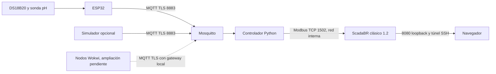

# Arquitectura



Windows → VMware → Debian 13 → Docker Compose. El controlador virtual sustituye
a una Raspberry Pi. Todos los servicios Docker están en la VM Debian. El ESP32
físico está fuera de la VM y accede por Wi-Fi; Wokwi se utilizará para añadir
nodos virtuales después de implementar el soporte multinodo. El editor y Wokwi
pueden ejecutarse en Windows. MQTT y Modbus usan redes Docker diferentes; únicamente el
controlador está conectado a ambas. Modbus no publica ningún puerto del host.
La red HMI permite acceder a ScadaBR por un puerto vinculado a loopback.
No hay actuadores ni órdenes remotas en esta fase.

Un dispositivo autorizado por despliegue (`DEVICE_ID`). La identidad MQTT y el
topic están vinculados mediante ACL. Para añadir nodos hacen falta instancias y
mapas Modbus independientes o ampliar explícitamente el controlador.
La estrategia prevista y sus pruebas están en [wokwi.md](wokwi.md); no se da por
implementada la coexistencia de varios emisores.

## Contrato MQTT

Topic `farm/esp32-01/telemetry`, sin retain, máximo 1024 bytes:

```json
{"device_id":"esp32-01","seq":1,"timestamp":1793984400,"temperature_c":25.0,"ph":7.4}
```

El timestamp es Unix UTC, generado en el momento de la lectura (el ejemplo debe
actualizarse antes de enviarlo). Frescura máxima: 30 s; adelanto máximo: 5 s.
Secuencia estrictamente creciente y persistente por dispositivo. Se rechazan
campos adicionales, booleanos numéricos, NaN/Inf, datos fuera de rango físico,
desorden y saltos improbables. La última lectura válida permanece visible con
calidad inválida si falla una lectura; no se reemplaza con ceros inventados.

La secuencia y el último dato válido sobreviven a reinicios del controlador en
SQLite. Tras reiniciar se exige una lectura nueva para recuperar la calidad.
El reloj de Debian debe estar sincronizado. El watchdog también usa reloj
monótono para detectar pérdida de comunicación aunque cambie la hora del sistema.

## Registros Modbus

Host `controller`, TCP `1502`, unidad `1`, función **04 (Input Registers)**.
Direcciones expresadas como offset de protocolo desde cero:

| Offset | Valor | Tipo / conversión |
|---|---|---|
| 0 | Temperatura | entero 16 bits **con signo**, dividir por 100 |
| 1 | pH | entero 16 bits sin signo, dividir por 100 |
| 2 | Alarmas | máscara de bits |
| 3 | Calidad | 1 fiable, 0 ausente/inválida/antigua |
| 4 | Edad | segundos, saturación 65535 |
| 5 | Secuencia | 16 bits inferiores, solo diagnóstico |

Bits alarma: 1 temperatura fuera de 20–30 °C; 2 pH fuera de 6,5–8,5;
4 mensaje inválido; 8 dato ausente o antiguo. Pueden combinarse. Los umbrales
son demostrativos, no una recomendación de explotación acuícola. ScadaBR debe
mostrar la calidad junto al valor y generar alarma cuando sea cero.

Modbus es de solo lectura: las funciones de escritura y los holding registers
se rechazan. El refresco del mapa tarda como máximo aproximadamente un segundo.
